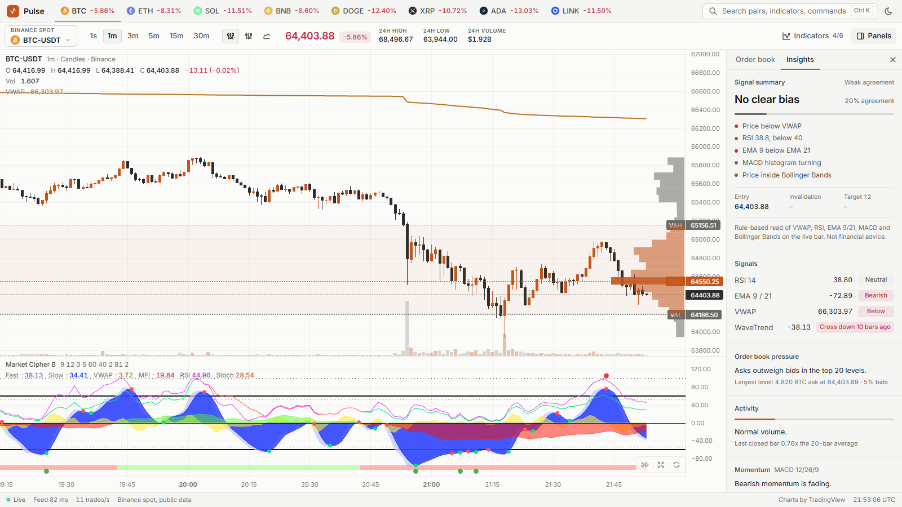
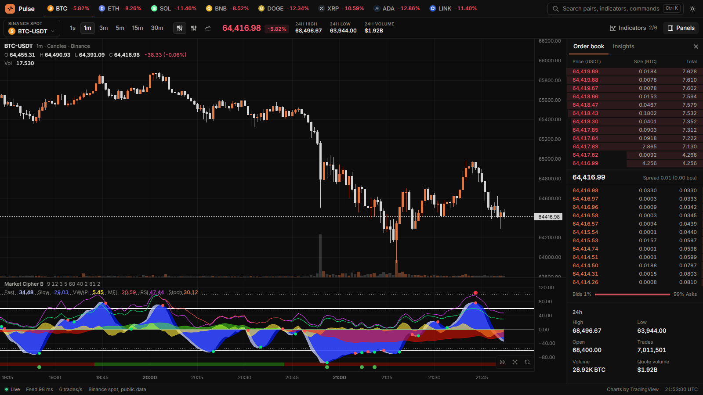

# Pulse Terminal

[](https://pulse-terminal.vercel.app)
[](https://github.com/TechTronixx/Pulse-Terminal)


A clean, focused, single-view terminal for watching the `1s` crypto market in real time, powered by Binance's WebSocket and REST APIs.

## Screenshots

|              Light Mode               |              Dark Mode              |
| :-----------------------------------: | :---------------------------------: |
|  |  |

## Live Demo

**https://pulse-terminal.vercel.app**

## Key Features

- **Orderbook Depth** — Real-time bid/ask spread and visible wall size.
- **Momentum Insights** — Automated tracking of volume spikes, RSI, and VWAP crossovers.
- **Fast Timeframes** — 1s, 1m, 3m, 5m, 15m, and 30m intervals.
- **Clean Charting** — Lightweight Charts v4.1.1 with custom light and dark themes.

## Tech Stack

- **Core** — Vanilla HTML5, CSS3, JavaScript (ES6+).
- **Charting** — Lightweight Charts v4.1.1.
- **Icons** — Iconify.
- **API** — Binance public WebSocket and REST API.

## Quick Start

No build tools or dependencies required. Open `Terminal-main.html` in any modern browser.

## Running Locally

```bash
git clone https://github.com/TechTronixx/Pulse-Terminal.git
cd Pulse-Terminal
```

Either open `Terminal-main.html` directly, or run a local server:

```bash
npx -y serve .
```

Then visit `http://localhost:3000`.

## Disclaimer

- Frontend-only. All requests target Binance's public endpoints.
- Does not place trades, hold funds, or access private accounts.
- Do not enter private keys or trading credentials anywhere in this app.
- You are responsible for complying with Binance's terms of service.
- Provided "AS IS", without warranty of any kind.

## License

MIT — see [LICENSE](./LICENSE).
